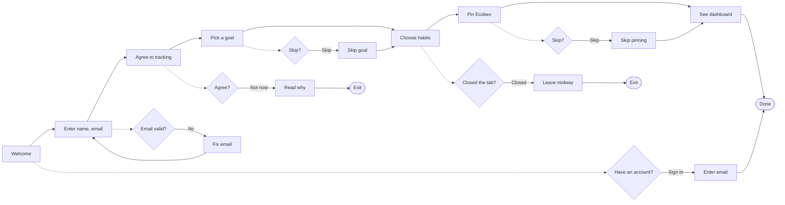
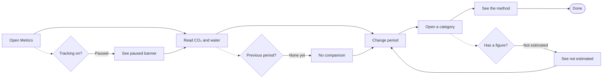
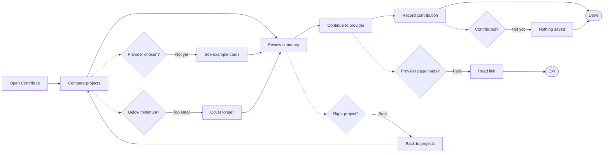
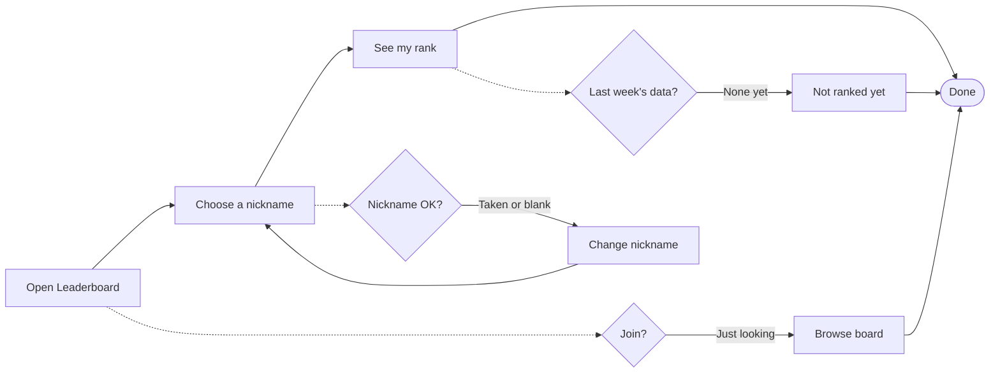
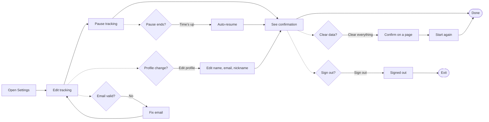

# Ecobex user flows

How a person gets from installing Ecobex to reading their footprint, contributing to a climate project, joining the leaderboard and changing settings.

**Mapped from:** The owner's answers, 16 inspiration screenshots, research/competitive-analysis.md, CLAUDE.md, PLAN.md, the dashboard code and pattern research captured 25 Nov 2026. Branch `extension-plan-and-factors` (5b895d2). Mode: new product, so every step is *planned*.

**Rule:** Nothing is built yet, so every step is planned. Where the owner's decisions and the project documents disagree, the owner's decision is stated and the difference is a gap.

**Status words.** *Planned*: decided in this map, not built. *Built*: in the repository. *Out of scope*: deliberately left for a later run.

**Verdict.** Five flows for one role, all planned. Three decisions block building: the project rules still say no accounts, the onboarding needs a consent step the Chrome Web Store requires, and no offset provider is chosen yet.

Data file: [`discovery/user-flows.json`](discovery/user-flows.json). Brief: [`discovery/flows-brief.json`](discovery/flows-brief.json). Open questions to send: [`discovery/flows-client-questions.md`](discovery/flows-client-questions.md).

## How the pieces connect

| Module | Owns | Fed by | Feeds |
|---|---|---|---|
| 01 Getting started | Install to first dashboard: sign-up, consent, goal, habits, pin | – | Metrics, Settings |
| 02 Metrics | Reading the footprint by period and category, with the method one tap away | Getting started, Settings | Contribute, Leaderboard |
| 03 Contribute | Choosing a verified project and leaving for its provider; recording a contribution | Metrics | Metrics |
| 04 Leaderboard | Opt-in weekly ranking by change against one's own last week | Metrics, Settings | – |
| 05 Settings | Tracked habits, goal, profile, leaderboard visibility, pause, clear data, sign out | Getting started | Metrics, Leaderboard |

Module names are this map's own until an information architecture exists.

## Gap register

| ID | Pri | Gap | Where | Flow | Status |
|---|---|---|---|---|---|
| G1 | P1 | Project rules say there are no accounts and value comes without one; the owner decided sign-up comes first | CLAUDE.md:6, 47, 55-56; PLAN.md:73 | F1 | open |
| G2 | P1 | The planned onboarding has no consent step, which the Chrome Web Store requires before any browsing data is collected | PLAN.md:110-116 | F1 | open |
| G3 | P1 | No verified provider, price per tonne or standard is chosen, so Contribute can only show example cards | PLAN.md:76 | F3 | open |
| G4 | P2 | Sign in works only in the browser where the account was made; on another browser the person is stuck with no account | F1 branch 'Have an account?'; CLAUDE.md:44 (no backend) | F1 | open |
| G5 | P2 | The copied Untitled UI set has no side navigation, toast or empty-state component, all of which these flows use | dashboard/src/components/untitled/ | F2 | open |
| G6 | P2 | Current pages are Home, Calculator and Results for typing habits in by hand, which the automatic-tracking decision retires | dashboard/src/App.jsx:17-20; dashboard/src/pages/Home.jsx:10-18 | F2 | open |
| G7 | P2 | The Home page promises video calls and water for every habit; factors.js has no video-call figure and no streaming water | dashboard/src/pages/Home.jsx:10; dashboard/src/data/factors.js | F2 | open |
| G8 | P2 | Leaderboard, Settings and Contribute choices are in no PLAN.md step | PLAN.md:110-145 | F4 | open |
| G12 | P2 | CLAUDE.md says the dashboard shows whatever the user types in onboarding, which the automatic-tracking decision replaces | CLAUDE.md:45 | F2 | open |
| G9 | P3 | Whether chosen providers accept amounts as small as a month of digital use is unknown | Research R11 (per-tonne pricing, minimum not found) | F3 | open |
| G10 | P3 | What a signed-out person sees when they reopen the dashboard is not designed; the flows assume Sign in | Entry point E7 | F2 | open |
| G11 | P3 | PLAN.md has the dashboard show prompts and energy as well; F2 leads with CO₂ and water only | PLAN.md:119 | F2 | open |

## Entry points

| ID | Kind | Way in | Opens | Designed | Source |
|---|---|---|---|---|---|
| E1 | external | Installed from the Chrome Web Store: Ecobex opens its welcome tab | Welcome | yes | flows-brief.json (S1); Mozilla Extension Workshop onboarding guidance (R5) |
| E2 | navigation | Side navigation: Metrics | Metrics | yes | flows-brief.json decision: side navigation (S1) |
| E3 | navigation | Side navigation: Contribute | Contribute: projects | yes | flows-brief.json (S1, S9) |
| E4 | navigation | Side navigation: Leaderboard | Leaderboard | yes | flows-brief.json (S1) |
| E5 | navigation | Side navigation, utility group: Settings | Settings | yes | flows-brief.json (S1); navigation-patterns: utility kept apart from global |
| E6 | card | 'Contribute to a climate project' card on Metrics | Contribute: projects | yes | F3 entries; pattern from Offset AI dashboard banner (S2, 11.webp) |
| E7 | external | Opening the Ecobex dashboard again later (bookmark or extension page) | Metrics | **no** | Inferred: every returning visit; signed-out visits go to SC15 |
| E8 | external | Reopening the welcome tab after closing it mid-onboarding | Welcome | yes | F1 branch 'Closed the tab?' resumes at the last step; no researched product documents this case |
| E9 | card | 'Join the leaderboard' from Settings, leaderboard visibility | Join the leaderboard | yes | flows-brief.json decision: Settings includes leaderboard visibility (S1) |
| E10 | external | Coming back to the Ecobex tab after visiting the provider | Project summary | yes | F3 step 5; owner decision to ask 'Did you contribute?' on return (S9) |

## Screens

| ID | Screen | Code name | Module | Status |
|---|---|---|---|---|
| SC01 | Welcome | `WelcomePage` | Getting started | planned |
| SC02 | Sign up | `SignUpPage` | Getting started | planned |
| SC03 | Privacy and consent | `ConsentPage` | Getting started | planned |
| SC04 | Your goal | `GoalPage` | Getting started | planned |
| SC05 | What to track | `HabitsPage` | Getting started | planned |
| SC06 | Pin Ecobex | `PinPage` | Getting started | planned |
| SC07 | Metrics | `MetricsPage` | Metrics | planned |
| SC08 | Category detail | `CategoryPanel` | Metrics | planned |
| SC09 | Contribute: projects | `ContributePage` | Contribute | planned |
| SC10 | Project summary | `ProjectSummaryPage` | Contribute | planned |
| SC11 | Provider's site (external) | `external` | Contribute | planned |
| SC12 | Leaderboard | `LeaderboardPage` | Leaderboard | planned |
| SC13 | Join the leaderboard | `JoinLeaderboardPanel` | Leaderboard | planned |
| SC14 | Settings | `SettingsPage` | Settings | planned |
| SC15 | Sign in | `SignInPage` | Getting started | planned |
| SC16 | Clear data confirmation | `ClearDataPage` | Settings | planned |

## Flows

Every flow is walked by the one role: *Person who installs Ecobex*.

### F1 Sign up and onboarding

**Goal:** U1. **Trigger:** Ecobex has just been installed from the Chrome Web Store. **Measure:** Seven screens from the welcome tab to the dashboard, two of them skippable; target under two minutes, to be tested. **Ways in:** E1, E8.

| # | Step | Screen | Person | Ecobex |
|---|---|---|---|---|
| 1 | Welcome | Welcome | Reads what Ecobex does and clicks Get started | Shows one line on what Ecobex measures, a progress indicator (1 of 6) and Get started; 'Already have an account? Sign in' below |
| 2 | Enter name, email | Sign up | Types a name and an email and continues | Checks the email format, saves name and email in this browser only (demo, no password) and moves on *Requires: A name and a valid email.* |
| 3 | Agree to tracking | Privacy and consent | Reads what is measured and what is never seen, then agrees | Lists what is measured (time, data, AI prompt counts and site domains, kept on this device) and what is never collected (full URLs, page content, prompt text); tracking starts only after 'Agree and start tracking' *Requires: An affirmative agreement (Chrome Web Store policy).* |
| 4 | Pick a goal | Your goal | Chooses Reduce my footprint, Understand it, or Contribute for what I can't reduce | Saves the goal; Back and Skip are available |
| 5 | Choose habits | What to track | Switches video streaming and AI chats on or off | Saves the choices; browsing and video calls are listed as 'not estimated yet' because factors.js has no figure for them |
| 6 | Pin Ecobex | Pin Ecobex | Pins the icon from Chrome's puzzle-piece menu, or skips | Shows where the puzzle-piece menu is and what pinning gives; Skip keeps it on the setup checklist |
| 7 | See dashboard | Metrics | Lands on Metrics | Shows the footprint with sample usage labelled 'Sample', and a setup checklist for any skipped step |

**Done when:** Onboarding is marked complete; the person is on Metrics with tracking agreed, and the next visit goes straight to the dashboard

**Branches**

- At step 1, *Have an account?* **Sign in** (alternate): Types the email used before → Finds the account saved in this browser and opens Metrics. Ends: success. *Works only in the browser where the account was created; there is no backend in v0*
- At step 2, *Email valid?* **No** (error): Reads the message and corrects the email → Says what is wrong: a missing @ or a missing domain such as .com. Ends: rejoin at step 2.
- At step 3, *Agree?* **Not now** (alternate): Chooses Not now → Explains that Ecobex cannot measure anything without agreement and that nothing has been collected; keeps the place in onboarding. Ends: exit. *The welcome tab can be reopened later (E8) and resumes at this step*
- At step 4, *Skip?* **Skip** (alternate): Clicks Skip → Leaves the goal unset and adds 'Set a goal' to the setup checklist. Ends: rejoin at step 5.
- At step 5, *Closed the tab?* **Closed** (alternate): Closes the welcome tab → Keeps every answer given so far in this browser. Ends: exit. *Reopening the welcome tab resumes at the last unfinished step*
- At step 6, *Skip?* **Skip** (alternate): Clicks Skip → Adds 'Pin Ecobex' to the setup checklist on Metrics. Ends: rejoin at step 7.

**Acceptance**

- Given a new install, when the person finishes or skips every step, then they land on Metrics and the next visit opens Metrics directly.
- Given the consent screen, when the person chooses Not now, then no usage is recorded and reopening the welcome tab returns to the consent screen.
- Given the sign-up form, when the email has no @, then the form stays on the step and says the email needs an @.

**Open questions**

- Sign-up first conflicts with the confirmed proposition 'no account needed to see value' (CLAUDE.md:6, PLAN.md:73). Keep sign-up first and reword the proposition, or revisit? *(for team)*
- What do the three goals change later in the product, if anything? *(for team)*
- Should the Pin step detect that Ecobex is pinned (the Chrome extensions action API can report it: https://developer.chrome.com/docs/extensions/reference/api/action), or only explain it? *(for team)*

### F2 Check my metrics

**Goal:** U2. **Trigger:** Wants to know what their digital habits cost the planet this week. **Measure:** CO₂ and water ranges readable on arrival without scrolling; any category in one click. **Ways in:** E2, E7.

| # | Step | Screen | Person | Ecobex |
|---|---|---|---|---|
| 1 | Open Metrics | Metrics | Opens Metrics from the side navigation | Shows Today by default with the 'Sample' label in v0 |
| 2 | Read CO₂ and water | Metrics | Reads the totals | Shows CO₂ and water each as a central value with a shaded range and '≈', an everyday equivalent such as phone charges, and the change against the previous period |
| 3 | Change period | Metrics | Switches between Today, 7 days and 30 days | Updates totals, the trend chart and the category list |
| 4 | Open a category | Category detail | Clicks a category such as Video streaming | Shows that category's range, its share of the total, its top sites by domain and the trend |
| 5 | See the method | Category detail | Opens 'How is this calculated?' | Shows the figure used, its range, confidence and source from factors.js in a panel on the same screen |

**Done when:** The person knows the range of their CO₂ and water for the chosen period, which category drives it, and where each number comes from

**Branches**

- At step 1, *Tracking on?* **Paused** (alternate): Reads the banner → Says tracking is paused and until when, with Resume. Ends: rejoin at step 2.
- At step 2, *Previous period?* **None yet** (alternate): Reads the totals → Shows no % change and says the comparison appears after the first full week. Ends: rejoin at step 3.
- At step 4, *Has a figure?* **Not estimated** (alternate): Opens video calls, or water for streaming → Shows the habit with 'not estimated yet' and no number, with a line on why. Ends: rejoin at step 3.

**Acceptance**

- Given a person on their first day, when they open Metrics, then the totals show as ranges labelled 'Sample' and no % change is shown.
- Given Metrics on 7 days, when the person opens Video calls, then it shows 'not estimated yet' and no number.
- Given any figure on Metrics, when the person opens 'How is this calculated?', then the factor, its range and its source link from factors.js are shown.

**Open questions**

- Which everyday equivalents should Metrics use? Every product picks a different set (phone charges, km driven, bottles, Netflix minutes). *(for team)*
- The method panel covers one figure; the full 'How we calculate' page is in the second run. Is a panel enough for v0? *(for team)*

### F3 Contribute to a climate project

**Goal:** U3. **Trigger:** Sees their footprint and wants to do something about what they cannot reduce. **Measure:** Provider, price per tonne and standard seen before leaving; three clicks from the side navigation to the provider's page. **Ways in:** E3, E6, E10.

| # | Step | Screen | Person | Ecobex |
|---|---|---|---|---|
| 1 | Open Contribute | Contribute: projects | Opens Contribute from the side navigation or the card on Metrics | Shows the last 30 days as a CO₂ range and explains that contributing funds a project and does not cancel their emissions |
| 2 | Compare projects | Contribute: projects | Reads three or four project cards | Each card shows provider, project, type (removal or avoidance), standard, price per tonne and 'your last 30 days ≈ $ at this price' |
| 3 | Review summary | Project summary | Picks a project | Shows a summary with the same facts, what the provider will ask for, and Continue to provider |
| 4 | Continue to provider | Provider's site (external) | Clicks Continue to provider | Opens the provider's project page in a new tab; Ecobex takes no payment |
| 5 | Record contribution | Project summary | Comes back and answers 'Did you contribute?' | If yes, saves the project and date in this browser and lists it under 'Your contributions'; the footprint stays as measured *Requires: Optional.* |

**Done when:** The provider's page has opened in a new tab after the person saw provider, price per tonne and standard; a contribution is recorded if they said so, and the footprint is unchanged

**Branches**

- At step 2, *Provider chosen?* **Not yet** (alternate): Reads the cards → Labels every card 'Example' and disables Continue to provider until real providers are chosen. Ends: rejoin at step 3. *The v0 state until the open provider decision is made*
- At step 2, *Below minimum?* **Too small** (alternate): Picks 3 months or a year instead → Recalculates the amount and the cost for the longer period. Ends: rejoin at step 3.
- At step 3, *Right project?* **Back** (alternate): Clicks Back → Returns to the cards with the scroll kept. Ends: rejoin at step 2.
- At step 4, *Provider page loads?* **Fails** (error): Returns to the Ecobex tab → Keeps the summary open with the provider's address to try again later. Ends: exit.
- At step 5, *Contributed?* **Not yet** (alternate): Chooses Not yet → Records nothing and closes the question. Ends: success.

**Acceptance**

- Given the projects list, when the person reads any card, then it shows provider, standard, removal or avoidance, price per tonne and the cost for their last 30 days.
- Given a project summary, when the person clicks Continue to provider, then the provider's page opens in a new tab and no payment happens in Ecobex.
- Given a recorded contribution, when the person opens Metrics, then the footprint is unchanged and the contribution is listed separately.

**Open questions**

- Which three or four verified providers and projects, at what price per tonne and to which standard? None is chosen yet (PLAN.md:76). *(for team)*
- Do the chosen providers accept amounts as small as a month of digital use? Gold Standard sells per tonne and its minimum was not found. *(for team)*
- Should Ecobex list tree-planting providers that say they are not certified offsets, or only certified ones? *(for team)*
- Are referral or affiliate links allowed? They would affect how neutral the list is. *(for team)*

### F4 Leaderboard

**Goal:** U4. **Trigger:** Curious how their week compares with others. **Measure:** Joined and ranked in two steps; own position always visible. **Ways in:** E4, E9.

| # | Step | Screen | Person | Ecobex |
|---|---|---|---|---|
| 1 | Open Leaderboard | Leaderboard | Opens Leaderboard from the side navigation | Shows the board of sample players, clearly labelled 'Sample players', ranked by % change against each player's own last week, with Join |
| 2 | Choose a nickname | Join the leaderboard | Clicks Join and types a nickname | Explains that only the nickname and the % change are shown, never the name, email or totals *Requires: A nickname.* |
| 3 | See my rank | Leaderboard | Reads the board | Adds the person under their nickname and pins their own row, even below the visible top of the list |

**Done when:** The person appears on the weekly board under a nickname, ranked by change against their own last week, and can see their own row

**Branches**

- At step 1, *Join?* **Just looking** (alternate): Reads the board without joining → Keeps Join available; nothing about the person is shown. Ends: success.
- At step 2, *Nickname OK?* **Taken or blank** (error): Types another nickname → Says the nickname is empty or already used. Ends: rejoin at step 2.
- At step 3, *Last week's data?* **None yet** (alternate): Reads their row → Shows 'Not ranked yet: you'll appear after your first full week'. Ends: success.

**Acceptance**

- Given a person who has not joined, when they open Leaderboard, then they see only sample players and a Join button, and no data of theirs.
- Given a person in their first week, when they join, then their row says 'Not ranked yet'.
- Given a joined person, when they turn off leaderboard visibility in Settings, then their row disappears from the board.

**Open questions**

- Does a week with tracking paused count towards the ranking, or is it shown as a partial week? *(for team)*
- % change rewards heavy users most (the largest drops come from the highest users). Should the change be capped or banded? *(for team)*
- Should two people whose ranges overlap be shown as tied? *(for team)*
- Does the week reset on the person's local Sunday or at one global time? *(for team)*

### F5 Settings

**Goal:** U5. **Trigger:** Wants to change what Ecobex tracks, how they appear, or to stop tracking for a while. **Measure:** Any setting changed in two clicks from Settings, saved without a separate Save step. **Ways in:** E5.

| # | Step | Screen | Person | Ecobex |
|---|---|---|---|---|
| 1 | Open Settings | Settings | Opens Settings from the utility group at the bottom of the side navigation | Shows sections: Tracking, Goal, Profile and leaderboard, Pause, Data and account |
| 2 | Edit tracking | Settings | Switches a habit on or off or changes the goal | Saves at once and says that past figures for that habit stay in history |
| 3 | Pause tracking | Settings | Chooses Pause for 1 hour, until tomorrow, or until I resume | Pauses at once, says paused time cannot be filled in later, and shows a paused banner on Metrics |
| 4 | See confirmation | Settings | Reads the note under the changed setting | Shows 'Saved' under the setting; Resume appears if tracking is paused |

**Done when:** The change is saved in this browser and Metrics and the Leaderboard reflect it on the next visit

**Branches**

- At step 2, *Profile change?* **Edit profile** (alternate): Changes name, email or nickname, or turns leaderboard visibility off → Saves at once; turning visibility off removes them from the board. Ends: rejoin at step 4.
- At step 2, *Email valid?* **No** (error): Corrects the email → Says what is wrong with it and keeps the old email until it is valid. Ends: rejoin at step 2.
- At step 3, *Pause ends?* **Time's up** (alternate): Opens Ecobex later → Has resumed tracking at the chosen time and says so once on Metrics. Ends: rejoin at step 4.
- At step 4, *Clear data?* **Clear everything** (alternate): Clicks Clear data, reads what will go, and types CLEAR → Shows a confirmation page listing what is deleted and that it cannot be undone; Confirms → Deletes account, answers, history and contributions from this browser and opens the welcome tab. Ends: success.
- At step 4, *Sign out?* **Sign out** (alternate): Clicks Sign out → Keeps the data in this browser and shows Sign in. Ends: exit.

**Acceptance**

- Given tracking paused for 1 hour, when the hour ends, then tracking resumes and Metrics says so once.
- Given Clear data, when the person confirms by typing CLEAR, then nothing Ecobex stored remains in the browser and the welcome tab opens.
- Given a habit switched off, when the person opens Metrics, then past figures for that habit stay in history and no new usage is added.

**Open questions**

- When a habit is switched off, should its past figures stay in totals, be hidden, or be deleted? *(for team)*
- Should Clear data offer an export first? GreenQuery, which needs no account, offers CSV export. *(for team)*

## Lifecycles

**Onboarding** starts at *Not started*. Terminal: none.

- Not started → In progress: Clicks Get started (Person who installs Ecobex)
- In progress → Complete: Finishes or skips the last step (Person who installs Ecobex)
- Complete → Not started: Clears all data in Settings (Person who installs Ecobex)

**Tracking** starts at *Awaiting consent*. Terminal: none.

- Awaiting consent → Active: Agrees on the consent screen (Person who installs Ecobex)
- Active → Paused: Pauses in Settings (Person who installs Ecobex)
- Paused → Active: Resumes, or the pause time ends (Person, or Ecobex at the chosen time)
- Active → Awaiting consent: Clears all data in Settings (Person who installs Ecobex)
- Paused → Awaiting consent: Clears all data in Settings (Person who installs Ecobex)

**Leaderboard membership** starts at *Not joined*. Terminal: none.

- Not joined → Joined, not ranked yet: Joins with a nickname (Person who installs Ecobex)
- Joined, not ranked yet → Ranked: First full week of data (Ecobex)
- Joined, not ranked yet → Not joined: Turns visibility off in Settings (Person who installs Ecobex)
- Ranked → Not joined: Turns visibility off in Settings (Person who installs Ecobex)

**Contribution** starts at *Browsing projects*. Terminal: Recorded.

- Browsing projects → Provider opened: Clicks Continue to provider (Person who installs Ecobex)
- Provider opened → Recorded: Answers yes to 'Did you contribute?' (Person who installs Ecobex)
- Provider opened → Browsing projects: Answers Not yet (Person who installs Ecobex)

## Screen states

| Screen | Loading | Empty | Error | Refresh | Offline |
|---|---|---|---|---|---|
| Metrics | Skeleton tiles while the browser's storage is read | Sample usage labelled 'Sample', with a line that real figures appear once the extension measures them | If the browser blocks storage, says Ecobex cannot save here and shows sample data only | Keeps the chosen period | Works; everything is local |
| Category detail | Skeleton chart | 'Not estimated yet' for habits with no figure | Same as Metrics | Keeps the category and period | Works |
| Contribute: projects | Skeleton cards | Example cards labelled 'Example' until providers are chosen | If a card's price is missing, says 'price not available' rather than hiding the card | Keeps the list | Cards show; Continue to provider says it needs a connection |
| Leaderboard | Skeleton rows | Sample players only, labelled 'Sample players' | Same as Metrics | Keeps the person's row pinned | Works; sample data is local |
| Settings | Instant | Defaults from onboarding | If saving fails, says the change was not saved and keeps the old value | Shows saved values | Works |

## What to change

- Update CLAUDE.md and PLAN.md to record sign-up first, the consent step, automatic tracking, side navigation, Contribute, Leaderboard and Settings, and reword the proposition's 'no account needed' line (F1; G1, G2, G8, G11, G12, S1, S9)
- Put the consent screen straight after sign-up and start (sample) tracking only after it is agreed (F1; G2, R6)
- Choose three or four certified providers with a published price per tonne and minimum, preferring removals as PLAN.md already says, and confirm they accept small amounts before building Contribute (F3; G3, G9, R11, R15, S5)
- Add side navigation, toast and empty-state components to the copied Untitled UI set before building the dashboard (F2; G5)
- Retire the Calculator and Results pages and fix the Home copy so it promises only habits with a sourced figure (F2; G6, G7)
- Tell people on the Sign in screen that their account lives in this browser only, so another browser does not look like a lost account (F1; G4)
- Show ranges as a central value with a shaded band and one plain-language line (F2; R9, S4)

## Research behind the flows

| ID | Flow | Kind | Product | Source | Read |
|---|---|---|---|---|---|
| R1 | F1 | comparable | Offset AI | https://dashboard.offsetai.app/get-started | 2026-11-25 |
| R2 | F1 | comparable | AIrth | https://getairth.com/auth | 2026-11-25 |
| R3 | F1 | analogous | Grammarly | https://mobbin.com/flows/1d0b78d2-f696-489e-a84c-268513341743 | 2026-11-25 |
| R4 | F1 | analogous | Loom | https://mobbin.com/flows/71293e43-0211-4017-853c-0b8871af50e9 | 2026-11-25 |
| R5 | F1 | pattern | Mozilla Extension Workshop onboarding | https://extensionworkshop.com/documentation/develop/onboard-upboard-offboard-users/ | 2026-11-25 |
| R6 | F1 | pattern | Chrome Web Store user data policy | https://developer.chrome.com/docs/webstore/program-policies/user-data-faq | 2026-11-25 |
| R7 | F2 | analogous | RescueTime | https://help.rescuetime.com/article/30-dashboard | 2026-11-25 |
| R8 | F2 | comparable | GreenQuery | https://chromewebstore.google.com/detail/greenquery/ncbhfkcfbgmomklbimabfkoppejkibpp | 2026-11-25 |
| R9 | F2 | pattern | ONS Service Manual: showing uncertainty | https://service-manual.ons.gov.uk/data-visualisation/guidance/showing-uncertainty-in-charts | 2026-11-25 |
| R10 | F2 | pattern | NN/g empty states | https://www.nngroup.com/articles/empty-state-interface-design/ | 2026-11-25 |
| R11 | F3 | comparable | Gold Standard Marketplace | https://marketplace.goldstandard.org/ | 2026-11-25 |
| R12 | F3 | comparable | RainforestLand | https://www.rainforest.land/marketplace | 2026-11-25 |
| R13 | F3 | comparable | Offset AI plans | https://www.offsetai.app/where-your-money-goes | 2026-11-25 |
| R14 | F3 | comparable | Ecologi | https://ecologi.com/solutions/individual-and-family | 2026-11-25 |
| R15 | F3 | pattern | Offset claim rules: CMA Green Claims Code, EU 2024/825, Oxford Offsetting Principles | https://www.gov.uk/government/publications/green-claims-code-making-environmental-claims/environmental-claims-on-goods-and-services | 2026-11-25 |
| R16 | F4 | analogous | Apple Fitness competitions | https://support.apple.com/guide/watch/apd68a69f5c7 | 2026-11-25 |
| R17 | F4 | analogous | Duolingo Leagues | https://blog.duolingo.com/duolingo-leagues-leaderboards/ | 2026-11-25 |
| R18 | F4 | pattern | Allcott 2011, neighbour comparison trials | https://econpapers.repec.org/RePEc:eee:pubeco:v:95:y:2011:i:9-10:p:1082-1095 | 2026-11-25 |
| R19 | F5 | analogous | RescueTime pause and data | https://help.rescuetime.com/article/413-the-rescuetime-assistant | 2026-11-25 |
| R20 | F5 | pattern | MOJ Design System: confirm an action | https://design-patterns.service.justice.gov.uk/patterns/confirm-an-action/ | 2026-11-25 |
| R21 | F5 | pattern | GitHub Danger Zone | https://docs.github.com/en/repositories/creating-and-managing-repositories/deleting-a-repository | 2026-11-25 |

## Charts

The charts summarise the tables above. A dashed node is a way out of the product; a red node marks a gap.

### F1 Sign up and onboarding

### F2 Check my metrics

### F3 Contribute to a climate project

### F4 Leaderboard

### F5 Settings

